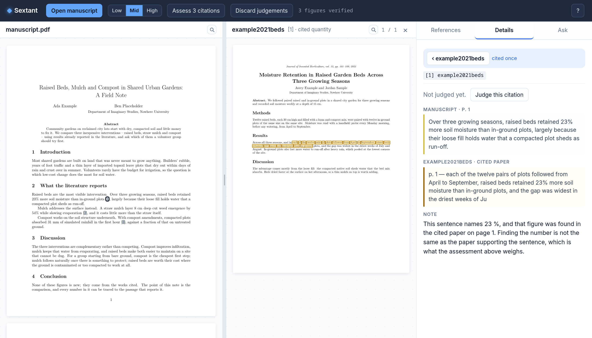

<h1><picture><source media="(prefers-color-scheme: dark)" srcset="docs/sextant-dark.svg"></picture> Sextant</h1>

**Click a citation in your manuscript. Land on the passage it cites.**

Sextant is a local reader for researchers writing or reviewing a paper, in any
field. It opens your manuscript beside the papers it cites, collects free and
legal copies of those papers for you, and highlights *where* in each source the
cited claim appears. When it cannot find the claim, it shows no highlight and
says so: a wrong highlight is worse than none, so Sextant never guesses.

[](LICENSE)




## Quick start

```bash
git clone https://github.com/Alessandro97/Sextant.git
cd Sextant
uv sync
uv run sextant serve        # then open http://127.0.0.1:8765
```

Click **Open document**, choose your compiled PDF, then **Go**. Sextant reads
its citations, fetches the cited papers into a `refs/` folder beside it, and
lists what it could not get with a link to each. No account, no upload: it
runs on your machine.

No manuscript at hand? Open `examples/demo/manuscript.pdf`, an invented paper
whose three citations all resolve, and click a citation number.

New to [uv](https://docs.astral.sh/uv/)? It is one command to install; see
[Setup](#setup).

## Why use it

- **Before you submit.** See which quoted figures cannot be found in the paper
  you cite, and which `.bib` entries have a DOI pointing at a different paper.
- **When you review.** Jump from each claim straight to the page it rests on,
  instead of searching forty PDFs.
- **When you start a bibliography.** One command collects the open-access PDFs
  of everything you cite, from arXiv to PubMed Central.

## What it reads

| You have | Sextant uses |
| --- | --- |
| a PDF compiled from LaTeX with `hyperref` | its citation links |
| a PDF from Word or elsewhere | numbered citations: `[12]` in the text, or superscripts as Vancouver and AMA styles print them |
| a `.bib` file beside the PDF | its entries; without one, the PDF's own reference list |
| the LaTeX source (`main.tex` and its `.bib`) | `fetch`, `linkcheck` and `audit` on the command line |

Numbered citations work best. Author–year styles (APA, Harvard) and PDFs built
with biblatex are not fully supported yet.

Sextant is developed and tested on Linux. Every dependency ships a wheel for
macOS (Intel and Apple Silicon) and Windows, so it should install there, but
neither has been tested yet.

## Your manuscript stays on your machine

- The reader is a page served from your own machine, on `127.0.0.1` unless
  you choose otherwise.
- Reading, locating quotes and `audit` work offline. Untick **Fetch the
  references not yet tried** when you open a manuscript, and the reader
  touches no network at all.
- `fetch` tells scholarly services the titles and DOIs you cite, and nothing
  else; [the table below](#collect-the-references-in-any-field) lists what each
  one is sent.
- Judgements and questions run only when you ask, through your own Claude Code
  login or API key, with no tools enabled. A judgement sends the citing
  sentence with its context and passages of the cited paper; `sextant ask`
  sends the whole PDF you ask about.

---

## What you can do with it

### Read the manuscript beside its sources

`sextant serve` opens a two-pane reader in your browser.

| | |
| --- | --- |
| **Click a citation** | the right pane opens the cited paper on that page; click the passage in Details to see it highlighted |
| **References** | every reference, its best score, how often you cite it, what is missing |
| **Find in either pane** | hits are blue, evidence is amber, so a search result never passes for a verified claim |
| **First time** | a short tour points out each part; **?** replays it |

### Collect the references, in any field

```bash
sextant fetch main.tex        # resolve and file every citation
sextant linkcheck main.tex    # does each DOI resolve to the paper claimed?
```

The reader does the same when you open a manuscript. `fetch` looks for a free,
legal copy of every cited work and files what it finds under `refs/`. What it
cannot get goes into `MISSING.md`, with the most direct link a person can open.

| Source | What it gives | What it is sent |
| --- | --- | --- |
| Crossref | the DOI an entry lacks; publishers' PDF links; an article's preprint | title or DOI |
| OpenAlex | every open copy it knows: publisher, repository, preprint server | DOI; the title if no DOI was found |
| PubMed Central | biomedical articles and author manuscripts, via its Cloud Service | DOI |
| Unpaywall | open copies, only with `SEXTANT_CONTACT` set, since it requires an email | DOI, your address |
| arXiv | preprints, searched by title, asked last | title words |
| 3GPP | specifications at the Release cited, converted from Word | spec number |
| ITU-R | a link to the Recommendation's page | nothing |

A copy is filed only when it shows the cited title in its first pages or the
DOI on its first page, so an erratum listed as the paper is refused. The
published version is preferred; a preprint or accepted manuscript is filed
only when no published copy downloads, and `MISSING.md` lists each one, since
its pages and figures can differ from the paper you cite.

Expect about three seconds a reference, plus a minute or more for each 3GPP
specification converted.

Got a paper some other way? Drop the PDF into `refs/inbox/` under any filename.
Each is matched to a citation key by the title and DOI on its own first page,
and an ambiguous file is reported rather than guessed. A file that cannot be
matched that way can be saved as `refs/<key>.pdf`, and is used as it is.

`linkcheck` catches `.bib` entries whose DOI resolves to a different paper than
the entry claims. Silent, common, and caught by nothing else in a LaTeX
workflow.

<details>
<summary><b>How fetching stays legal, polite and safe</b></summary>

- **Legal copies only.** Nothing behind a login, a CAPTCHA or a JavaScript
  challenge is fetched, and no shadow library is used.
- **Polite.** Hosts are asked no faster than their terms and robots.txt allow.
  A source that does not answer is reported as "try again later" and asked
  again next time.
- **Private.** The table lists what each service is told; the sites holding
  the copies see only the download.
- **Safe.** Every link and redirect comes from someone else's metadata, so each
  must lead to a public address: nothing is fetched from your own machine or
  network. Names are resolved locally to check this, so behind a proxy that
  alone can resolve names, `fetch` cannot run.
- **Grounded.** A scan with no text to check is filed only when a source lists
  it under the DOI your `.bib` gives.
</details>

### Check quantities mechanically

```bash
sextant audit main.tex
```

Reports where each claimed figure sits in the cited paper. No model involved.

### Have citations judged, when you ask

Nothing is judged automatically.

- **Assess N citations**: the whole manuscript
- **Judge this citation**: just the one you are reading
- **Discard judgements**: clears them, re-runs nothing

A `Low · Mid · High` selector sets how much of each cited paper the model
reads. It matters:

| effort | per citation | × 30 citations |
| --- | --- | --- |
| Low | ~1,100 tokens | 32,000 |
| **Mid** *(default)* | ~3,700 | 110,000 |
| High | ~12,300 | 370,000 |

Measured on a 34-paper library whose median paper is 46,000 characters;
longer papers cost more at High. **Mid** always includes the abstract, where
the headline number usually lives.
**High** sends the whole paper, up to 250,000 characters. Beyond that a
document goes as excerpts, because a 375-page specification is a quarter of a
million tokens for a single citation.

If a judgement missed why a reference belongs, argue with it. It is made again
with your note, marked as argued in the library, and revertible to the one it
replaced.

### Locate a quote, exactly

The guarantee everything else rests on, in one command:

```console
$ sextant index paper.pdf
paper.pdf: indexed 1 pages as aaf9e2975cd6dd98

$ sextant locate aaf9e2975cd6dd98 "aggregate write throughput"
page 1, chars 112-138, 3 rects        # exit 0

$ sextant locate aaf9e2975cd6dd98 "a claim the paper never makes"
not found in document                 # exit 1
```

Either the text is in the document and you get coordinates you can draw a box
around, or the command fails. Nothing fabricates a citation past this.

Add `--json` for the rectangles themselves.

### It never says "supported"

Verdicts are `located`, `not-found`, `no-source` and `no-claim`. There is
deliberately no `supported`, and that is measured, not modesty:

> Requiring a claimed value to sit adjacent to its unit finds 7 of 7 true
> claims and admits 1 of 14 perturbed ones. Searching for the bare value
> instead finds 7 of 7 and admits 14 of 14.
>
> — [`src/sextant/audit/screen.py`](src/sextant/audit/screen.py)

A survey paper genuinely contains many numbers. Presence in a document is not
support for the claim citing it, so Sextant tells you where to look and leaves
the judgement to you.

### English, mostly

Sextant is built for manuscripts and papers in English, and its interface is
in English.

- **Any language:** locating a quote, since it matches the text exactly.
- **Latin alphabet:** fetching. A copy is confirmed by its title, so in
  another script a paper is fetched only if it prints its DOI on its first page.
- **English:** everything that reads prose: choosing the passages a judgement
  sees, sentence boundaries, finding a printed reference list, the units
  `audit` recognises, spotting an erratum. In other languages these degrade.

---

## Setup

Sextant needs [uv](https://docs.astral.sh/uv/) and nothing else. It fetches
Python 3.13 for you if you do not have it.

```bash
curl -LsSf https://astral.sh/uv/install.sh | sh              # macOS, Linux
powershell -c "irm https://astral.sh/uv/install.ps1 | iex"   # Windows

git clone https://github.com/Alessandro97/Sextant.git
cd Sextant
uv sync
```

`uv sync` installs the exact versions the tests ran against, and nothing is
compiled. Run each command as `uv run sextant …`.

### What needs what

| | requires |
| --- | --- |
| `index`, `locate`, `audit`, the two-pane reader | **nothing**: offline, no account |
| `fetch`, `linkcheck` | the network |
| citation judgements, the Ask tab, `sextant ask` | Claude Code **or** an API key |

With Claude Code installed there is nothing to configure: Sextant runs
`claude -p` against the login you already have.

Without it, judging is not offered and the Ask tab hands you the grounded
prompt to paste elsewhere. Everything in the first two rows is unaffected.

`sextant ask` is the exception. It talks to the API directly, and Claude Code
will not satisfy it:

```bash
echo "ANTHROPIC_API_KEY=sk-ant-..." > .env
uv run sextant ask "What sample size does it assume?" --paper <id>
```

Sextant reads `.env` from the working directory itself, so the key never enters
your shell environment and no other tool inherits it. Setting the variable
directly also works, and takes precedence.

### Optional

**LibreOffice**: to fetch 3GPP specifications, which 3GPP publishes as Word
files, and to read a reference you supply as `.doc`, `.docx`, `.rtf` or `.odt`.
A document someone sent can make LibreOffice copy files from your disk into
the PDF it writes, so one you supply is converted only in a sandbox, which
needs [bubblewrap](https://github.com/containers/bubblewrap) on Linux.
Elsewhere, and without LibreOffice, save such documents as PDF yourself;
specifications are linked in `MISSING.md` if they cannot be converted.

**`SEXTANT_CONTACT`**: your own email address. Crossref and PMC give politer
service to requests carrying one, and Unpaywall refuses requests without one,
so without it Unpaywall is skipped. It is sent to those three and nowhere
else; without it Sextant identifies itself only by URL.

**`SEXTANT_OPENALEX_KEY`**: a free [OpenAlex key](https://help.openalex.org/api/authentication/).
Without one OpenAlex allows about a hundred title searches a day; lookups by
DOI are free, and Sextant finds DOIs through Crossref first.

<details>
<summary><b>Installing without uv</b></summary>

`requirements.txt` pins the same versions `uv.lock` holds:

```bash
python -m venv .venv
. .venv/bin/activate          # .venv\Scripts\activate on Windows
pip install -r requirements.txt
pip install -e .
```

Python 3.13 or newer is required, and pip will not fetch it for you.
`requirements-dev.txt` adds pytest. Both are generated from the lock, and each
carries the command that regenerates it on its first line.
</details>

<details>
<summary><b>Running the tests</b></summary>

```bash
uv run pytest            # fast, offline, free
uv run pytest -m live    # real services: Crossref (free), the Anthropic API (~$0.10)
```

A dozen tests want a real document, which cannot be committed, so each is a
path you supply and the test is skipped when it is unset:

| variable | points at |
| --- | --- |
| `SEXTANT_TEST_PAPER` | a compiled manuscript PDF carrying hyperref links |
| `SEXTANT_TEST_TEX` | a LaTeX manuscript |
| `SEXTANT_TEST_BIB` | a BibTeX bibliography |
| `SEXTANT_TEST_PROJECT` | a folder with `main.tex` and its `.bib` files |
| `SEXTANT_TEST_BRACKETED` | a typeset paper citing as `[12]` |
| `SEXTANT_TEST_SUPERSCRIPT` | a Word-produced PDF citing in superscript |

Most assert properties, so any document of the right shape will do. Those on
`SEXTANT_TEST_TEX`, `SEXTANT_TEST_PAPER` and `SEXTANT_TEST_BIB` also check
counts measured on the author's own manuscript, and fail on another.
</details>

---

## Feedback

Sextant is young. If it cannot read your manuscript, or misses a paper that
has a free copy online, please
[open an issue](https://github.com/Alessandro97/Sextant/issues) with the
citation style, your operating system and the output of the command. Those
reports are how it learns new layouts.

## License

[GNU AGPL v3](LICENSE) or later.

That matches [PyMuPDF](https://pymupdf.readthedocs.io), which reads every PDF
here and is itself AGPL. The bundled Inter font keeps its own
[SIL Open Font License](src/sextant/web/static/fonts/LICENSE).

## Acknowledgements

Thank you to arXiv for use of its open access interoperability. Sextant also
relies on the open APIs of Crossref, OpenAlex, PubMed Central and Unpaywall.
